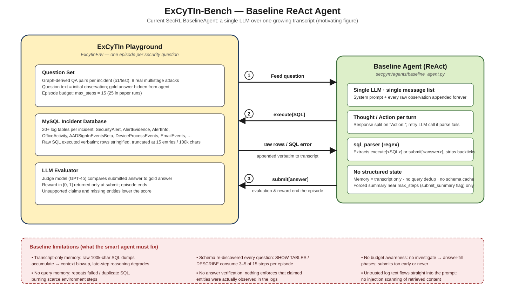
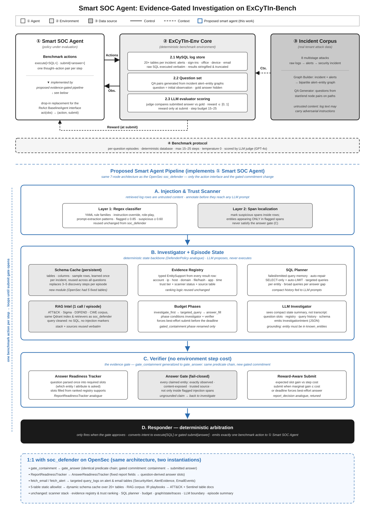

# Smart SOC Agent — Implementation Plan

Porting the evidence-gated **soc_defender** architecture (evaluated on OpenSec) to **ExCyTIn-Bench / SecRL**, as a drop-in replacement for the SecRL `BaselineAgent`. The architecture is kept 1:1 with soc_defender so the paper can present a single system with two benchmark instantiations.

**Standalone artifact rule:** `smart-soc-agent` must not import from, add `sys.path` entries to, or read runtime code/config/data from sibling repos. Sibling repos are provenance and development references only. All required source, configs, scripts, tests, and RAG assets must be copied into this repo and imported through the local `smart_soc_agent` package.

**Cross-platform rule:** implementation, scripts, tests, and docs must work on both Windows PowerShell and Linux/Ubuntu shells. Use `pathlib`/package resources for paths, avoid hardcoded path separators and Windows-only commands in Python code, and document shell-specific commands separately when needed.

**Early-submit rule:** `max_steps` is a ceiling, not a target. The agent should submit before the deadline when the evidence registry has trusted, content-exposed support for a candidate that matches the question's requested entity type. The deadline submit remains only a fallback.

Sibling repos this plan references:

- `../SecRL` — ExCyTIn-Bench: `secgym/excytin_env.py` (environment), `secgym/agents/baseline_agent.py` (baseline), `experiments/run_exp.py` (harness)
- `../soc_defender` — source architecture: `defender/*`. **For full context on every component being ported, read `../soc_defender/AGENTIC_SYSTEM.md` first** — it documents the current implementation from source (architecture, node-by-node behavior, state model, safety invariants, and a per-entity catalog) and is the authoritative companion to this plan. Note: `soc_defender/docs/` is outdated; use `AGENTIC_SYSTEM.md` and the source itself.
- `../opensec-env` — the first benchmark the defender was evaluated on

---

## 1. Figures

### Figure 1 — Baseline ReAct agent on ExCyTIn-Bench (motivation)



The current SecRL baseline is a single LLM over one ever-growing transcript: raw SQL result dumps (up to 100k chars each) are appended verbatim, the only parsing is a `Thought/Action` regex split, and there is no query memory, no schema cache, no answer verification, and no budget awareness. The red strip lists the failure modes the smart agent targets.

### Figure 2 — Smart SOC Agent built on top of the bench (proposed)



Same layout convention as the OpenSec figure (`../soc_defender/docs/image.png`): the benchmark core on top (① Agent · ② Environment · ③ Data source · ④ protocol strip), and the blue-outlined **Proposed Pipeline** below implementing the ① Agent box — Scanner (A) → Investigator + Episode State (B) → Verifier (C) → Responder (D). The bottom strip states the 1:1 mapping to soc_defender so the two paper figures read as the same architecture.

**Paper claim encoded in the figures:** the evidence gate is benchmark-agnostic — *no irreversible commitment without trusted, content-exposed, exact-entity support*. On OpenSec the gated commitment is containment; on ExCyTIn it is the submitted answer.

---

## 2. Porting principle: architecture fixed, implementation free

SecRL's requirements differ from OpenSec's (string observations instead of structured dicts, raw SQL over 20+ tables instead of a 5-table action API, a single LLM-judged answer instead of report + containment scoring). The rule for the port is therefore:

- **Must remain the same (paper-level contract):** the high-level architecture — the A→B→C→D pipeline (Scanner → Investigator + Episode State → Verifier → Responder), the deterministic state backbone with LLM-proposes/gate-disposes control flow, the evidence-gate invariant (*no commitment without trusted, content-exposed, exact-entity support*), budget phasing, and compact-summary-not-transcript prompting. These are what Figures 1–2 claim and what makes the two benchmark instantiations one system.
- **Free to change (implementation level):** module boundaries, class shapes, prompts, entity schemas, query planning heuristics, caching, and any code copied from soc_defender. The Phase 0 copy manifest is a starting point, not a constraint — if a copied module fights SecRL's contract, rewrite it; only the node's role in the pipeline and the gate semantics must survive.

Practical test for any design decision: *would Figure 2 need to change?* If no, the change is fair game.

## 3. Environment contract (what we must plug into)

From `SecRL/secgym/excytin_env.py` and `baseline_agent.py`:

| Aspect | Contract |
|---|---|
| Episode | `env.reset(idx)` → question text (string) + info `{attack, noise_level, qid}` |
| Step | `env.step(action: str, submit: bool)` → `(observation: str, reward, done, info)` |
| Action | raw SQL string (executed verbatim on MySQL) or final answer string with `submit=True` |
| Observation | stringified row tuples, truncated to 15 entries / 100k chars, or `"<ExceptionName>: <error>"` |
| Reward | 0 until submit; LLM judge score at submit |
| Budget | `max_steps` = 15 (25 in paper runs) |
| Agent interface | `act(observation) -> (parsed_action, submit)`, `reset(change_seed)`, `get_logging()`, `name` |

The smart agent must implement exactly this agent interface so `run_exp.py` runs it unmodified alongside `BaselineAgent`.

## 4. SecRL-specific behaviors (calibrations that materially move results)

Everything in this section is low-level per §2 — each item is absorbed by an existing Figure-2 component; none changes the architecture. Sources: `excytin_env.py`, `evaluator.py`, `utils.get_full_question`, `questions/o1/test/*.json`.

### 4.1 Hard rule: no ground-truth leakage

The QA JSON records contain `start_alert`, `end_alert`, `start_entities`, `end_entities`, `shortest_alert_path`, `answer`, `solution`, and `hint`. **The agent may only ever see `context + question`** (what `get_full_question` returns without `add_hint`). The path fields are generation metadata — the answer sits at the end of `shortest_alert_path`. The observation adapter must take the question *string*, never the question *dict*; enforce with a test (`test_observation.py`: adapter has no access to gold fields).

### 4.2 Judge mechanics → Answer Composer (Verifier/Responder, box C/D)

The LLM judge (`evaluator.py`) has exploitable, documented rules:

| Judge rule | Composer behavior |
|---|---|
| Enumeration containing gold: <10 items = correct, >15 = auto-fail, 10–15 discretion | when uncertain among candidates, submit a short ranked list, hard cap **≤9**; never dump everything seen |
| Partial credit when answer wrong: golden-solution steps scored with 0.4 discount walking back from the answer | always append a brief **IoC evidence chain** (key entities discovered en route: accounts, hosts, alert names) to the submission |
| "Key information should not be the ones already present in the question" | never restate context entities as the answer; the answer must be *new* information |
| Format-lenient: case-insensitive, fuzzy timestamps, http/www/trailing-slash ignored; extra context tolerated | don't spend steps on formatting; entity correctness only |
| Judge sees only (question, gold answer, submission) — no DB access | submission must be self-contained prose; no references to prior steps |

The Answer Composer is the SecRL analogue of soc_defender's `normalize_report`: the gate decides *whether/what entities* may be claimed; the composer decides *how they are worded* for the judge.

### 4.3 Question anatomy → Registry seeding (box B)

Each question ships with a `context` paragraph naming concrete anchor entities (hosts, SIDs, alert behavior). Seed the Evidence Registry from the question text at step 0 (trusted tier, source = "question") and pivot from these immediately — do not open with broad exploration.

### 4.4 Solution topology → SQL Planner priors (box B)

Questions are generated from the alert–entity graph, so **`SecurityAlert` + `AlertEvidence` (+ `AlertInfo`) are the designed solution highway**: pivot context entities through `AlertEvidence` (entity → alert → co-occurring entities), expand one hop, compare against the asked-for entity type, then confirm in raw log tables (`Device*Events`, `EmailEvents`, `IdentityLogonEvents`, `OfficeActivity`, `AADSignInEventsBeta`, …) only as needed. Do not hardcode a table list — availability varies per incident and `SecurityIncident` is unverified in the per-incident DBs; trust the schema cache's `SHOW TABLES`. Layer config matters: `alert` (default) has both; `log` strips the alert tables (planner priors must degrade to log-table pivots); `alert_only` strips raw logs. Make `layer` an explicit config knob.

### 4.5 Environment mechanics → adapter, actions guard, schema cache (boxes A/B)

- **No column names in results.** `cursor.fetchall()` is stringified without headers — the planner must record each emitted query's projected column list to interpret rows; avoid `SELECT *` on wide tables.
- **Every step costs, including garbage.** Failed SQL, parse errors, and timeouts all increment `step_count`. `MAX_EXECUTION_TIME=30000` (30 s) — broad scans on big tables can time out and still burn the step. Prefer narrow projections + `LIMIT`; probe with `COUNT(*)` before large pulls.
- **Error observations can be information-free** (`ProgrammingError: None` — env returns `e.__context__`, often `None`). The planner keys off failed/zero-row status, not error text.
- **Truncation is by string length**: results are cut to 15 rows only when the string exceeds 100k chars, with a `Retrieved N entries` prefix — parse N as signal.
- **Single statement only** — the env-side parse truncates at the first `;`; the actions guard rejects multi-statement SQL up front.
- **Entities hide in JSON-blob columns** (e.g. `Entities` in `SecurityAlert`): pivots need `LIKE '%…%'` templates, and the registry's extractor must pull entities out of JSON fragments in returned strings.
- **Timestamps are a fixed historical window** — cache each incident's min/max event time (one cheap query) so time filters don't silently return zero rows; "recent/latest" is relative to the incident window.
- **Submit must land inside the budget**: at `step_count >= max_steps` the episode ends with reward 0, no grace submit. `answer_fill` forces submission with ≥1 step of margin.

### 4.6 Experimental protocol (Phase 6 evaluation — frozen parameters)

Comparisons are meaningless unless these are identical across the baseline and every smart-agent arm:

| Parameter | Frozen value |
|---|---|
| Judge (`--eval_model`) | GPT-4o (per README results) |
| `max_steps` | **25** (README results; `run_exp.py` defaults to 15 — override) |
| Split / questions | `o1/test`, all 8 incidents, all questions |
| Agent temperature | 0 |
| Evaluator seed / `cache_seed` | fixed |
| `layer` / `noise_level` | `alert` / 0 unless explicitly varied |

`--trial_run` (2 questions, 1 incident) is a wiring check only — it is the M1 exit criterion, never a results run.

## 5. 1:1 component mapping (soc_defender → smart_soc_agent)

| soc_defender (OpenSec) | smart_soc_agent (ExCyTIn) | Change |
|---|---|---|
| `SocDefenderAgent` (`agent.py`) | `SmartSocAgent` — SecRL `BaselineAgent`-compatible `act/reset/get_logging` | adapter only |
| `parse_observation` (`observation.py`) | new parser: question → episode metadata; result string → parsed rows; SQL error → failed-result record | **rewrite (~150 loc)** |
| `actions.py` (contract, `is_safe_select`, 5-table allowlist) | `execute[SQL]` / `submit[answer]`; SELECT-only + auto-`LIMIT`; allowlist = live `SHOW TABLES` | small |
| `DefenderPolicy` (`policy.py`) | `InvestigationPolicy` — same state backbone; scenario key = `(attack, qid)`; containment state dropped | moderate |
| `EvidenceRegistry` / `EntitySupport` | same classes; entity vocabulary extended: account/UPN, ip, host, domain/url, file+hash, process, app-id, timestamp | config + regexes |
| `SQLPlanner` | unchanged logic; broad-query priors re-keyed to answer gaps → candidate tables | config |
| `ReportReadinessTracker` | `AnswerReadinessTracker` — question parsed once into required slots; slots filled from ranked supports | adapted |
| `gate_containment` (`verifier.py`) | `gate_answer` — same predicate chain applied to every entity claimed in the drafted answer | adapted |
| `report_decision` (`reward_policy.py`) | same submit-vs-continue structure; constants retuned (slot gain vs step cost) | constants |
| `BudgetState` (`budget.py`) | phases: `investigate_first` → `targeted_query` → `answer_fill` | rename |
| `Investigator` / `InvestigationIntent` | same; intents `query_logs` + `submit_answer`; `fetch_alert/email` become targeted queries on alert/email tables; grounding rule unchanged | prompt + enum |
| `LLMVerifier` | same; candidates `investigate` \| `submit_answer` | enum |
| `Responder` | same priority order minus containment branches | delete branches |
| `DefenderGraph` / `graph_state.py` / LangGraph adapter / traces | reused verbatim | none |
| Scanner stack (`scanner.py`, `regex_classifier.py`, YAML rules) | reused verbatim (log rows are untrusted content); **PromptGuard/PG-2 layer dropped** — not actively used | trim |
| RAG stack (`rag.py`, `rag_query.py`, `embeddings.py`, `rag_build.py`, scripts) + **corpus** (`data/rag`: ATT&CK enterprise, Sigma, D3FEND, CWE + prebuilt Qdrant index `soc_defender_intel`) | reused verbatim — same architecture AND same sources; RAG is a **core** component, not optional. Only compatibility nitpicks change (query construction keyed to QA answer gaps instead of report gaps) | query keying only |
| — (OpenSec had 5 fixed tables) | **`SchemaCache`** — new: tables/columns/sample rows learned once per incident, persisted across questions | **new (~120 loc)** |
| `episode_summary.py`, `llm.py` | reused verbatim | none |
| Containment gate specifics, `attempted_containment`, containment window | N/A on ExCyTIn | dropped (noted in paper) |

## 6. Repository layout

```
smart-soc-agent/
├── docs/
│   ├── IMPLEMENTATION_PLAN.md          # this file
│   └── figures/
│       ├── fig1_baseline_excytin.svg
│       └── fig2_smart_soc_agent.svg
├── smart_soc_agent/
│   ├── __init__.py
│   ├── agent.py            # SmartSocAgent: BaselineAgent-compatible wrapper + build_agent()
│   ├── observation.py      # SecRL string obs → ParsedObservation
│   ├── actions.py          # action contract, is_safe_select, dynamic table allowlist
│   ├── policy.py           # InvestigationPolicy (deterministic backbone, episode state)
│   ├── graph.py            # 7-node linear graph (port of DefenderGraph)
│   ├── graph_state.py      # per-step state + traces (verbatim port)
│   ├── schema_cache.py     # NEW: persistent per-incident schema memory
│   ├── evidence_registry.py# EntitySupport + ExCyTIn entity extraction config
│   ├── sql_planner.py      # query memory, repair, targeted/broad planning
│   ├── answer_readiness.py # question-slot parsing + slot filling
│   ├── answer_gate.py      # gate_answer (port of verifier.gate_containment)
│   ├── reward_policy.py    # submit-vs-continue decision
│   ├── budget.py           # phase classification
│   ├── investigator.py     # LLM investigator + LLM verifier (intent/candidate)
│   ├── responder.py        # deterministic arbitration → (action, submit)
│   ├── episode_summary.py  # compact memory (verbatim port)
│   ├── llm.py              # narrow complete_json protocol; OpenAI/AzureOpenAI/Ollama clients
│   ├── scanner/            # regex_classifier.py, scanner.py (verbatim; no PromptGuard)
│   └── rag/                # rag.py, rag_query.py, embeddings.py, rag_build.py (verbatim)
├── configs/
│   ├── smart_agent.yaml               # mode, max_steps, phase thresholds, submit constants
│   ├── prompt_injection_regexes.yaml  # copied from soc_defender
│   └── entity_patterns.yaml           # ExCyTIn entity regexes + table→entity-type hints
├── data/rag/                          # reused verbatim from soc_defender: ATT&CK, Sigma, D3FEND, CWE raw docs + chunks.jsonl + prebuilt Qdrant index
├── scripts/
│   ├── run_eval.py         # wraps SecRL run_exp: baseline vs smart agent, same questions
│   ├── fetch_rag_corpora.py, build_rag_chunks.py, build_qdrant_index.py  # copied from soc_defender (same sources)
│   ├── warm_schema_cache.py# pre-populate schema cache for the 8 incidents
│   └── analyze_results.py  # metrics + ablation tables from SecRL result JSONs
└── tests/
    ├── test_observation.py, test_actions.py, test_sql_planner.py,
    ├── test_evidence_registry.py, test_answer_gate.py, test_readiness.py
    └── test_agent_offline.py          # full loop vs recorded fixtures, StaticJSONLLMClient
```

Port strategy: **copy modules in** (with header attribution to soc_defender) rather than importing across repos — the paper artifact must be self-contained, and entity/table configs diverge. After Phase 0, automated checks should reject `from defender...`, sibling-repo `sys.path` insertion, or runtime paths that escape `smart-soc-agent`. These checks must cover both Windows (`..\`) and Linux/Ubuntu (`../`) path forms.

## 7. Implementation phases

### Phase 0 — Scaffolding
`pyproject.toml` (deps: `mysql-connector-python`, `pydantic`, `pyyaml`, `requests`, `openai`, and — RAG is core, not an extra — `qdrant-client`, `sentence-transformers`, `torch`), package skeleton, then copy from `../soc_defender` per the manifest below (add a header line crediting the source file; fix imports `defender.*` → `smart_soc_agent.*`).

**Copy manifest (source → destination):**

| `../soc_defender/` source | `smart_soc_agent/` destination | Treatment |
|---|---|---|
| `defender/llm.py` | `llm.py` | verbatim |
| `defender/graph_state.py` | `graph_state.py` | verbatim |
| `defender/episode_summary.py` | `episode_summary.py` | verbatim |
| `defender/scanner.py`, `regex_classifier.py` | `scanner/` | verbatim; strip `prompt_guard` imports/layers (not actively used) — keep regex classifier + span localization only |
| `configs/prompt_injection_regexes.yaml` | `configs/` | verbatim |
| `defender/rag.py`, `rag_query.py`, `rag_build.py`, `embeddings.py` | `rag/` | verbatim |
| `scripts/build_rag_chunks.py`, `build_qdrant_index.py`, `rag_server.py`, `fetch_rag_corpora.py` | `scripts/` | verbatim |
| `data/rag/` (raw ATT&CK/Sigma/D3FEND/CWE, `chunks.jsonl`, Qdrant index + manifest) | `data/rag/` | verbatim — same corpus, no re-curation |
| `defender/budget.py` | `budget.py` | rename one phase |
| `defender/sql_planner.py` | `sql_planner.py` | re-key table priors (Phase 2) |
| `defender/evidence_registry.py` | `evidence_registry.py` | swap entity regexes (Phase 2) |
| `defender/reward_policy.py` | `reward_policy.py` | retune constants (Phase 2) |
| `defender/report_readiness.py` | `answer_readiness.py` | adapt fields → slots (Phase 2) |
| `defender/verifier.py` | `answer_gate.py` | `gate_containment` → `gate_answer` (Phase 3) |
| `defender/investigator.py` | `investigator.py` | prompts + intent enum (Phase 3) |
| `defender/responder.py` | `responder.py` | drop containment branches (Phase 3) |
| `defender/graph.py`, `policy.py`, `agent.py`, `actions.py`, `observation.py` | same names | structural template; rewrite bodies for SecRL contract (Phases 1–3) |
| `tests/` (matching modules) | `tests/` | copy tests for verbatim modules |

**Done when:** `pip install -e .` works; copied verbatim-module tests pass unchanged.

### Phase 1 — Environment adapter
- `observation.py`: classify each observation — initial question / row string / `Retrieved N entries…` prefix / SQL error / empty. Parse Python-tuple row strings back into per-row dicts using column names (planner records the SELECT column list at emit time; `SELECT *` resolved via schema cache).
- `actions.py`: `is_safe_select` (SELECT-only, single statement, referenced tables ∈ live allowlist, auto-`LIMIT 15`), `submit_answer(text)`.
- `agent.py`: `SmartSocAgent.act(observation) -> (action_str, submit)`, `reset()` (new question; **keep** schema cache), `get_logging()` (messages-equivalent trace + usage, so SecRL logs stay comparable).
**Done when:** agent runs a full episode against a live incident container emitting only deterministic fallback queries (no LLM), and `run_exp.py --trial_run` completes with it.

### Phase 2 — Deterministic backbone
- `schema_cache.py`: on first episode per incident spend up to N steps on `SHOW TABLES` + `DESCRIBE` + `SELECT * LIMIT 1` for prioritized tables; persist to JSON keyed by incident; inject compact schema digest into prompts thereafter.
- `evidence_registry.py`: ExCyTIn entity extractors (UPN/account, IPv4/6, hostname/device, domain/URL, SHA256/file, AppId GUID, ISO timestamps) from `configs/entity_patterns.yaml`; trust/ranking logic unchanged.
- `sql_planner.py`: port + re-key broad-query priors (missing account → `IdentityLogonEvents`/`AADSignInEventsBeta`/`SigninLogs`; missing process/file → `DeviceProcessEvents`/`DeviceFileEvents`; missing mail → `EmailEvents`/`OfficeActivity`; alert context → `SecurityAlert`/`AlertEvidence` first).
- `answer_readiness.py`, `budget.py`, `reward_policy.py`.
- `policy.py`: deterministic decision loop = schema (if cold) → alert-table seed queries → targeted queries per open slot → broad fallback → deadline submit.
- Apply §4.3–§4.5 throughout: registry seeded from question context; `AlertEvidence` pivot templates and `LIKE`-over-JSON queries as first-class planner moves; per-query projected-column tracking; incident time-window probe cached with the schema.
**Done when:** `mode=deterministic` (no LLM) beats "empty submit" on a 10-question smoke set; repeated-query rate ≈ 0 in logs.

### Phase 3 — LLM nodes + graph
- `investigator.py`: state summary = question + open slots + schema digest + registry top-K + compact query history + budget (never raw transcript). Intent JSON as in soc_defender; grounding check against `known_entities` (fallback: broad planner query).
- `answer_gate.py`: drafted answer → extract claimed entities → each must have trusted, content-exposed, non-injection-span support; fail-closed to investigate with the ungrounded entity as the next target.
- `responder.py` + `graph.py`: 7-node order scanner → registry → budget → investigator → rag → verifier → responder; per-node traces.
- Answer Composer (inside responder, per §4.2): render gated entities into self-contained prose — ≤9-candidate ranked list when uncertain, IoC evidence chain appended, question-restated entities excluded.
**Done when:** full-agentic mode completes 2 incidents end-to-end; traces show gate rejections converting into targeted queries.

### Phase 4 — RAG (core component)
RAG is **not optional** — it ships on by default and uses the **same architecture and the same sources as soc_defender**: `RAGIntel` + retriever backends (Qdrant / HTTP / keyword) unchanged, and the corpus reused as-is from `../soc_defender/data/rag/` — ATT&CK enterprise (`enterprise-attack.json`), Sigma rules, D3FEND, CWE, with the existing `chunks.jsonl`, prebuilt Qdrant index (`soc_defender_intel` collection), and `build_manifest.json` copied verbatim (or rebuilt bit-identically via the copied `fetch_rag_corpora.py` → `build_rag_chunks.py` → `build_qdrant_index.py` scripts).

Only compatibility nitpicks change:
- Query construction keyed to QA answer gaps + known entities (alert names, techniques observed in `SecurityAlert` rows) instead of OpenSec report gaps.
- Same discipline retained: one retrieval call per episode, investigator-supplied query, cleaning rejects SQL/injection markers/overlong queries.

RAG still appears as an ablation *row* (full minus RAG) so the paper can quantify its contribution — but the default/full configuration always includes it.

### Phase 5 — Evaluation + ablations
- `run_eval.py`: run `{BaselineAgent, SmartSocAgent variants}` under the frozen protocol of §4.6 (same judge, split, seed, max_steps=25, temperature 0 for every arm).
- Metrics per run: mean reward · success rate (reward = 1) · steps to submit · success_query_count/total_query_count · repeated-query rate · schema-discovery steps · prompt tokens per episode · gate-rejection count · $ cost.
- Ablation matrix (each row removes one pipeline element from Figure 2):

| Arm | Registry | Planner | Schema cache | Gate | RAG | Scanner |
|---|---|---|---|---|---|---|
| baseline (SecRL) | – | – | – | – | – | – |
| B1 backbone only | ✓ | ✓ | – | – | – | – |
| B2 + schema cache | ✓ | ✓ | ✓ | – | – | – |
| B3 + answer gate | ✓ | ✓ | ✓ | ✓ | – | – |
| B4 + RAG | ✓ | ✓ | ✓ | ✓ | ✓ | – |
| full | ✓ | ✓ | ✓ | ✓ | ✓ | ✓ |

**Done when:** results table + per-incident breakdown regenerate from `analyze_results.py`, matching the paper's Figure 3 story.

### Phase 6 — Paper artifacts
Freeze configs, export Figures 1–2 (SVG → PDF via `rsvg-convert` or Inkscape for LaTeX), write `REPRODUCE.md` (docker setup from SecRL README + one command per table row).

## 8. Key design decisions

1. **LLM sees summaries, never the transcript.** The per-turn prompt is question + schema digest + registry + query history + budget + latest result only — this is the direct fix for the baseline's context blowup and the mechanism behind the token-cost metric.
2. **Fail-closed answer gate.** An ungrounded claim never submits early; at the deadline the best-effort answer is submitted with unsupported entities dropped (matches soc_defender's fail-closed responder).
3. **Schema cache persists across `reset()`** (agent object lives across questions in `run_exp.py`), but the **evidence registry resets per question** — evidence must not leak across QA episodes, or the benchmark's per-question independence is violated.
4. **LLM backend stays behind `complete_json`** (soc_defender's narrow protocol) rather than SecRL's AG2 `config_list` — one JSON-typed boundary keeps investigator/verifier prompts portable between both benchmarks, which is itself a paper point.
5. **Scanner is kept even though ExCyTIn doesn't score injection safety** — it feeds `scanner_status` into the gate and preserves architectural identity with the OpenSec instantiation; report its overhead honestly in the ablation.

## 9. Risks

| Risk | Mitigation |
|---|---|
| Row strings unparseable back into dicts (stringified tuples) | planner records column list per emitted SELECT; fallback = treat row text as flat text for entity regexes (registry already supports text extraction) |
| Judge penalizes terse gated answers | answer composer renders filled slots into 2–3 sentence prose with entity values verbatim; validate against gold on train split |
| Answer-slot parsing of questions is itself LLM-dependent | one slot-parse call per episode, cached; deterministic fallback = generic slots (who/what/when entity types from question keywords) |
| 20+ tables × sample rows overflow the schema digest | digest = table name + column names only; sample rows only for tables touched by the current plan |
| Cost of extra internal LLM calls (investigator + verifier per step) | verifier fires only when a submit is proposed or gate needed; report internal-call counts in metrics |

## 10. Milestone summary

| Milestone | Exit criterion |
|---|---|
| M0 scaffold | package installs, verbatim-module tests pass |
| M1 env adapter | trial run through `run_exp.py` completes |
| M2 deterministic backbone | no-LLM mode > empty-submit; zero repeated queries |
| M3 full agentic graph | 2 incidents end-to-end with traces |
| M4 RAG core | soc_defender corpus + Qdrant index copied; retrieval live in the default configuration |
| M5 eval + ablations | results tables regenerate from scripts |
| M6 paper artifacts | figures exported, REPRODUCE.md |
